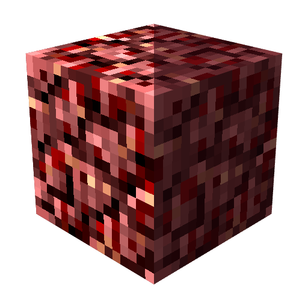
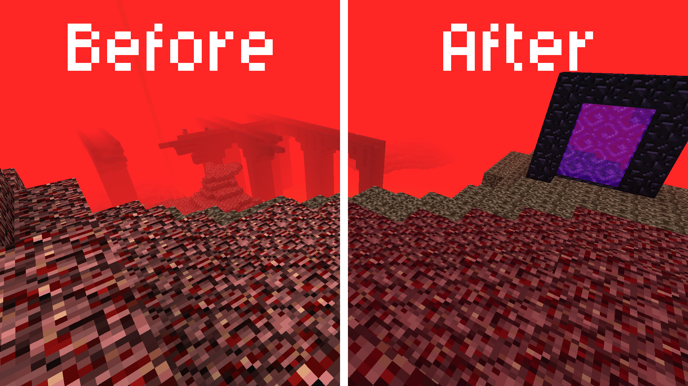

<div align="center">
  <h1>
    <br/>
    Better Netherrack<br/>
    
    <br/>
    <a href="https://modrinth.com/resourcepack/better-netherrack">
      </img>
    </a>
  </h1>
</div>

**A Minecraft Java Edition resource pack** that beautifully refines the infamous Netherrack texture while honoring its roots. Instead of completely changing the iconic block, this pack smooths out the harsh, noisy patterns of the classic texture to make the Nether much easier on the eyes and comfortable for long exploration sessions.

## 🔍 Overview



## 🔗 Dependencies

This repository uses [Nix](https://nixos.org) to provide a consistent development environment via `nix-shell` with all the necessary tools.

> [!WARNING]
> Nix is natively supported only on Unix-like operating systems (Linux and macOS). Windows users can use it via WSL2 (Windows Subsystem for Linux).

### ✍️ Manual Installation (Alternative)
If you prefer not to use Nix, or if you are on a system that doesn't support it, you can install all the required tools manually. You will need:

* [GNU Make](https://ftp.gnu.org/gnu/make/) – For automating the packaging process.
* [minizip-ng](https://github.com/zlib-ng/minizip-ng) – For packaging of zip archives.
* [yq](https://github.com/mikefarah/yq) – For parsing TOML.

## 🛠️ Packaging

> [!TIP]
> 📁 [`src/`](src/) – Contains the source files of the pack.
>
> 📦 [`packs/`](packs/) – Contains final, ready-to-use packs.

1. **Enter the Nix environment:**
   Open your terminal in the root directory of the repository and run:
   ```bash
   nix-shell
   ```
   *This will automatically download and install all necessary tools.*

2. **Build the pack:**
   Inside the Nix shell, run the following command to package:
   ```bash
   make
   ```

## 💝 Acknowledgements

* This pack is a backport of [Better Old Netherrack](https://modrinth.com/resourcepack/better-old-netherrack) originally created by [AT-3109](https://modrinth.com/user/AT-3109).
* This repository is generated from the [mc-pack-env](https://github.com/segabass65/mc-pack-env) template.
